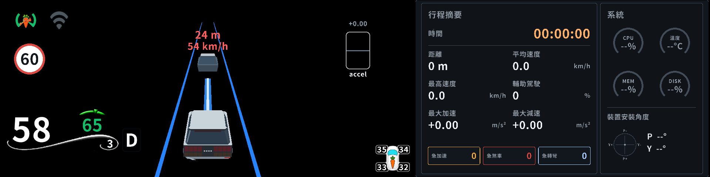
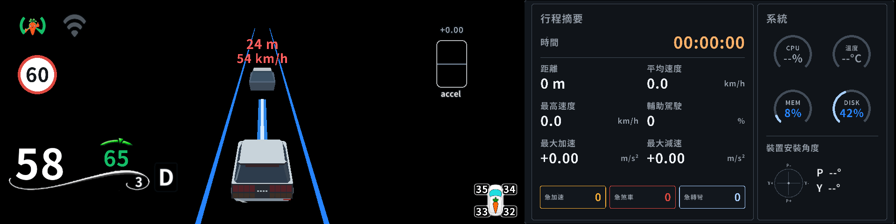
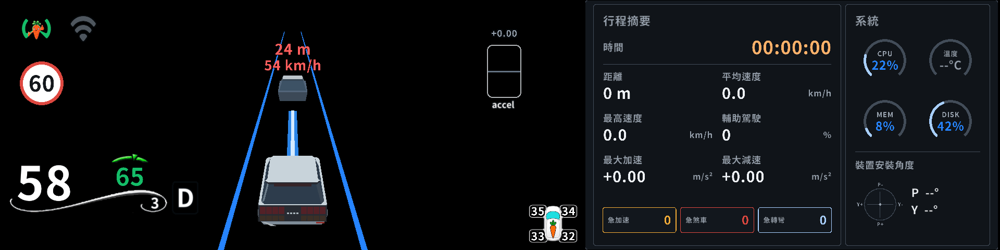
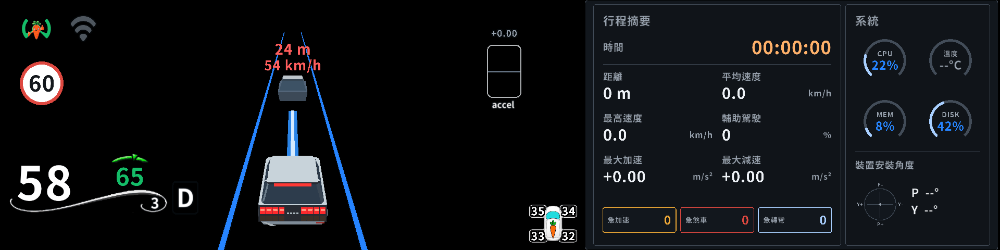
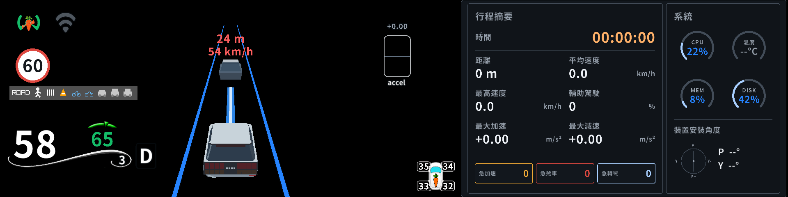
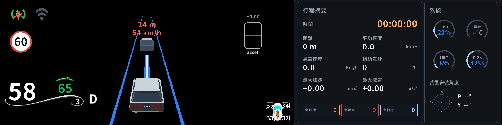
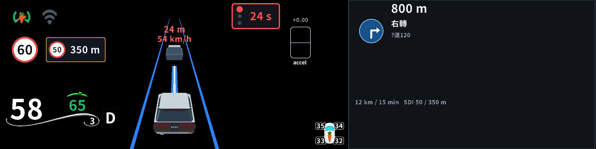
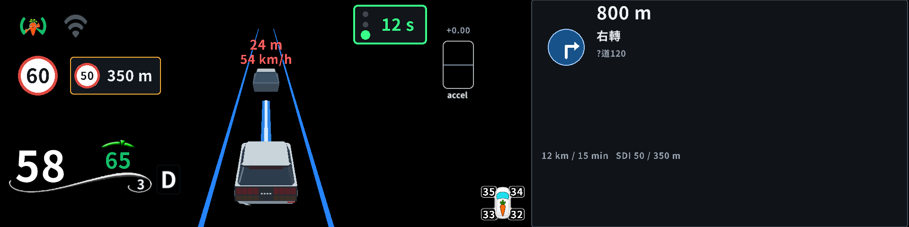
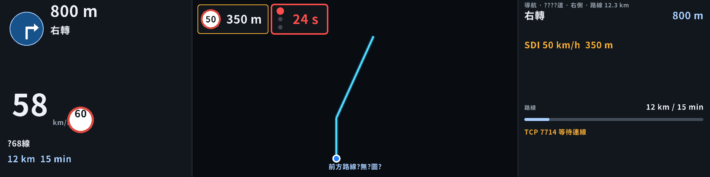
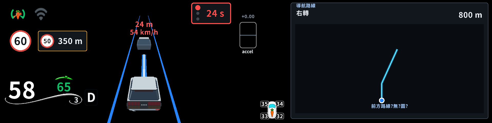

# 實際 HUD 畫面參考

[回首頁](../README.md) · [Mac Vision 操作說明](../MacVision/README.md)

以下圖片及 GIF 由本專案 main 的實際 HUD renderer 輸出，固定 Carrot helper `a564ce1dc082909b1fdc73b72e64d920336b34d6`，套用主分支 `386e730` 的 Mac Vision、繁中與導航補丁。輸入為離線模擬的速度、導航與燈號，沒有車輛連線，也不是實車拍攝或生成式概念圖。尺寸為 1920 × 480，實際 TURZX 面板比例及設定可能不同。

[原始渲染流程](../scripts/render_hud_gallery.py) · [GitHub Actions 渲染紀錄](https://github.com/FANHAOHSIANG/carrotMAC-HUD/actions/runs/45793915252)

## IONIQ 5 車尾燈

### 正常行車



### 煞車



### 左方向燈


### 右方向燈



### 煞車與雙黃燈



GIF 使用實際 renderer 的燈號亮／滅兩個相位循環；閃爍間隔為文件展示用 500 ms，不是量測的車輛閃爍頻率。煞車燈示範踩下／放開，方向燈示範亮／滅，煞車與雙黃燈可同時呈現。自車燈號根據有效車況訊號，不需要 YOLO。

## 物件辨識類別圖示



這張使用模擬的類別結果，只展示實際 ROAD 圖示列的繪製。未提供相機校正或道路影格，所以不展示 3D 物件定位，不代表模型辨識準確率。

## 導航資料畫面











全導航模式的合成路線與交流道標題亦由原 renderer 繪出；目前有部分繁中字型缺字顯示問號，保留實際輸出，未以人工文字修飾。沒有真實地圖影像，故只顯示路線。號誌、速限及測速距離是模擬值，實際須依 Carrot Bridge／C4 接收資料。

更多資料來源及 C4 直連差異：[Carrot Bridge HUD 指南](https://github.com/FANHAOHSIANG/Carrot-Bridge/blob/main/docs/HUD_zh-TW.md)。

## 安裝與重現

使用 main ZIP 的 `Start-IONIQ5-HUD.command` 安裝選用功能；目前不改 stable 已驗收入口。若開發者需要重新截圖，在固定 helper 套用相同 overlays、執行 MacVision/install.py 安裝顯示掛鉤後，使用含 raylib 5.5.0.4、numpy、Pillow 與圖形環境的 Python 執行：

```bash
python scripts/render_hud_gallery.py /path/to/carrot docs/images/hud
```

請在獨立離線環境執行，不使用實際車端資料。
